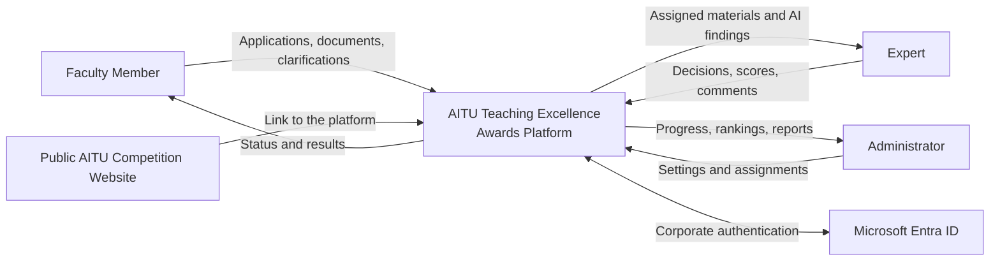
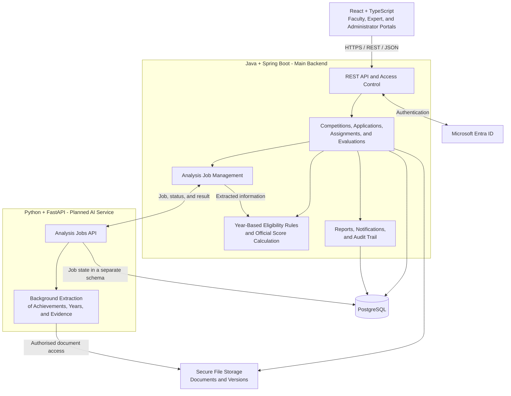

<a name="aitu-teaching-excellence-awards"></a>
<h1 align="center">AITU Teaching Excellence Awards Management System</h1>

**[Open Live Demo →](https://heazytt.github.io/AITU_Awards/)** · **[YouTrack - Project Tasks →](https://aitu-awards.youtrack.cloud)**

**Diploma Project:** Development of a Web Platform for Conducting the “Best University Teacher” Competition with Automated Document Verification and Decision Support.

**Team**

- **Vyacheslav Yakupov, SE-2403** - Java/Spring Boot backend, business logic, REST API, database, and backend testing.
- **Marlen Zhumagulov, SE-2424** - AI document analysis using Python/FastAPI, evaluation of verification methods, integration, and deployment.
- **Gulnaz Yeskermes, SE-2425** - frontend development, UX, user scenarios, and interface testing.

**Supervisor:** Yersultan Tulebayev, Senior Lecturer, School of Software Engineering.

**Client:** Academic and Methodological Department of Astana IT University.

<a name="table-of-contents"></a>
<h2 align="center">Table of Contents</h2>

- [Introduction](#introduction)
- [Features](#features)
- [Data and AI-Assisted Document Verification](#data-and-ai-assisted-document-verification)
- [Current Scope and Future Development](#current-scope-and-future-development)
- [Getting Started and Testing](#getting-started-and-testing)
- [Repository Structure](#repository-structure)
- [Documentation](#documentation)
- [Version Control Workflow](#version-control-workflow)
- [Application Prototype](#application-prototype)
- [Client Input and Supervisor Feedback](#client-input-and-supervisor-feedback)
- [Architecture and Diagrams](#architecture-and-diagrams)
- [Conclusion](#conclusion)
- [References](#references)

<a name="introduction"></a>
<h2 align="center">Introduction</h2>

This diploma project aims to develop and evaluate a unified platform for the AITU faculty awards competition. It brings application submission, supporting documents, expert evaluation, score calculation, and preparation of results into one workflow.

The project addresses a fragmented manual process in which document completeness, deadlines, eligibility, and changes to scores are difficult to track. Its intended users are faculty members, experts, and competition administrators.

The research component investigates whether AI-assisted document verification can reduce review time without increasing missed eligibility violations. AI provides extracted information and supporting passages; experts confirm evaluations, and the Competition Commission makes the final decision on winners.

The repository currently contains an interactive frontend prototype, an initial Spring Boot backend with Microsoft authentication configuration and user persistence, and process and database diagrams. The frontend and backend are not yet connected into a complete application.

<a name="features"></a>
<h2 align="center">Features</h2>

The browser prototype demonstrates the following workflows using sample data:

| Role | Demonstrated functionality |
| --- | --- |
| Faculty member | Nomination selection, criterion-level claimed scores, attachment metadata, completeness indicators, and simulated application submission |
| Expert | Assigned-application queue, criterion review, decisions and comments, score validation, clarification decisions, and simulated evaluation completion |
| Administrator | Application register, search and filters, competition overview, and nomination rankings |
| All users | Landing page, demonstration sign-in, and English, Russian, and Kazakh interface switching |

The planned MVP extends these screens with corporate authentication, server-side access restrictions, shared application storage, secure document uploads and version history, expert assignments, AI assistance, official score calculation, PDF/XLSX reports, and an audit trail.

The evaluation structure uses three blocks with limits of **40, 50, and 10 points**. Competition rules, nomination thresholds, and eligible achievement years must be configurable and enforced by the backend.

<a name="data-and-ai-assisted-document-verification"></a>
<h2 align="center">Data and AI-Assisted Document Verification</h2>

The planned Python/FastAPI service will extract an achievement description, its year, and a supporting passage from an uploaded document. The main backend will apply two separate checks:

1. Whether the achievement year falls within the competition's configured five-year eligibility window.
2. Whether it falls within the faculty member's confirmed employment period at AITU.

Each check will return **Meets the condition**, **Does not meet the condition**, or **Insufficient information**. The achievement year must be distinguished from the document's issue year. Missing, unreadable, or ambiguous evidence requires clarification; an analysis failure leaves the document available for manual review.

**AI does not assign official scores or select winners.** Extracted information and verification results require expert confirmation.

The evaluation plan proposes a pilot dataset of **50 documents** in the available Russian, Kazakh, and English materials: **20 for development, 10 for validation, and 20 for final testing**. Two annotators will establish reference answers. Documents from the same faculty member and closely related template versions will remain in the same partition.

A text-extraction/OCR and rule-based baseline will be compared with AI-assisted extraction using identical eligibility rules. Planned targets are year-extraction **F1 ≥ 0.85**, eligibility-violation **recall ≥ 0.90** for each check, and evidence support of at least **95%**. A separate reviewer experiment targets a **25% reduction in median active review time** without increasing missed violations.

These are evaluation targets, not achieved results. No trained model, evaluation dataset, or measured AI results are included in the repository yet. Real faculty evidence documents must not be committed to Git.

<a name="current-scope-and-future-development"></a>
<h2 align="center">Current Scope and Future Development</h2>

| Component | Current implementation | Further development |
| --- | --- | --- |
| Frontend | React 19, TypeScript, Vite, Tailwind CSS, and role-specific demonstration screens | Backend integration, authenticated sessions, persistent forms, real uploads, and reports |
| Backend | Java 25, Spring Boot 4.1.1, Spring Security OIDC configuration, user persistence, and an initial Flyway migration | Competition APIs, application workflow, assignment permissions, eligibility rules, scoring, and audit records |
| Database | PostgreSQL configuration and a migration for users | Remaining competition entities, constraints, and migrations |
| AI service | Service description and placeholder source/test directories | FastAPI endpoints, background analysis jobs, extraction methods, and evaluation |
| Deployment | GitHub Actions workflow for building and deploying the frontend to GitHub Pages | Backend and AI deployment, Docker Compose, secure file storage, backups, and separate test/production configuration |

**Backend authentication status:** The initial Spring Security configuration for Microsoft Entra ID sign-in using OAuth 2.0 and OpenID Connect is in place. The team is currently waiting for the university to provide the app registration credentials and configuration (`MICROSOFT_TENANT_ID`, `MICROSOFT_CLIENT_ID`, and `MICROSOFT_CLIENT_SECRET`). Integration and end-to-end verification of corporate sign-in remain pending until these are provided.

The frontend sign-in buttons currently navigate to demonstration pages. They do not start the backend Microsoft authentication flow. Application and evaluation changes remain in React state and reset when the page is reloaded; only the language preference is saved in localStorage. Selecting a file records its name and metadata in the interface without uploading its contents. Export controls are interface placeholders.

The second phase includes verifier and commission portals, appeals, Student Choice Award, and additional university-system integrations.

<a name="getting-started-and-testing"></a>
<h2 align="center">Getting Started and Testing</h2>

<h3 align="center">Frontend Prototype</h3>

**No local frontend setup is required to explore the prototype.** All current frontend screens are available on **[GitHub Pages](https://heazytt.github.io/AITU_Awards/)**.

For local development, use **Node.js 22.12 or later** and npm. The deployment workflow uses Node.js 22. From the repository root:

```sh
cd frontend
npm ci
npm run dev
```

Open [the local prototype](http://localhost:3000). The frontend runs independently of the backend and AI service. Stop the server with Ctrl+C.

To create and preview a production build, run these commands from `frontend/`:

```sh
npm run build
npm run preview
```

The preview also uses port 3000 by default; stop the development server before starting it. The GitHub Pages workflow configures the deployment base path through `VITE_BASE`.

<h3 align="center">Backend</h3>

Use **JDK 25**, an installed **Maven**, and **PostgreSQL**. A Maven Wrapper is not included.

The Microsoft Entra ID credentials listed below are still awaiting provision by the university. Corporate sign-in can be integrated and verified once they are available.

1. Create the PostgreSQL database `aitu-awards` and configure a database user.
2. Set `DB_URL`, `DB_USERNAME`, and `DB_PASSWORD` in your shell or IDE using [.env.example](.env.example) as a reference. `SERVER_PORT` defaults to `8080`.
3. Set `MICROSOFT_TENANT_ID`, `MICROSOFT_CLIENT_ID`, and `MICROSOFT_CLIENT_SECRET` for a Microsoft Entra ID Web app registration. For the default local port, register `http://localhost:8080/login/oauth2/code/microsoft` as its redirect URI.
4. Run the backend from the repository root:

```sh
mvn -f backend/pom.xml spring-boot:run
```

The root `.env` file is not loaded automatically; its values must be supplied to the backend process. Flyway applies the available migration on startup, and Hibernate validates the schema. Backend Microsoft sign-in starts at [the local OAuth2 endpoint](http://localhost:8080/oauth2/authorization/microsoft). API documentation is available at [Swagger UI](http://localhost:8080/swagger-ui/index.html).

<h3 align="center">Verification</h3>

The backend currently includes a Spring application-context smoke test. With the database and Microsoft configuration available, run from the repository root:

```sh
mvn -f backend/pom.xml test
```

There is no frontend test script or AI test implementation yet. `npm run build` checks the frontend production bundle; it does not verify the competition workflow. Planned verification covers access restrictions, completeness and deadline checks, score limits, concurrent changes, document versions, exports, AI failures, and backup recovery.

<a name="repository-structure"></a>
<h2 align="center">Repository Structure</h2>

```text
backend/                      Java + Spring Boot main backend
  pom.xml                     Dependencies and build configuration
  src/main/java/              Authentication, user model, and service layers
  src/main/resources/         Application configuration and database migrations
  src/test/                   Backend tests
frontend/                     React + TypeScript interface prototype
  src/app/                    Application setup and routes
  src/pages/                  Landing page, sign-in, workspaces, and translations
  public/                     Static assets
ai-service/                   Planned Python + FastAPI document-analysis service
  app/                        Source directory placeholder
  tests/                      Test directory placeholder
docs/                         English documentation and diagrams
docs-for-us/                  Russian documentation and matching diagram versions
infra/                        Infrastructure directory placeholder and notes
.github/workflows/            Frontend build and GitHub Pages deployment
.env.example                  Safe backend environment-variable examples
```

<a name="documentation"></a>
<h2 align="center">Documentation</h2>

| Topic | Resource |
| --- | --- |
| English documentation index | [docs/](docs/) |
| Russian team documentation | [docs-for-us/](docs-for-us/) and [Project Overview](docs-for-us/project-overview.md) |
| Backend source and configuration | [Source](backend/src/main/java/) and [Application Configuration](backend/src/main/resources/application.yaml) |
| Frontend prototype | [Routes](frontend/src/app/routes.tsx), [Workspaces](frontend/src/pages/WorkspacePages.tsx), and [Criteria and Sample Data](frontend/src/pages/criteria.ts) |
| AI service scope | [AI Service](ai-service/README.md) |
| Application process | [Mermaid Source](docs/diagrams/bpmn/application_progress.mmd) and [SVG Export](docs/diagrams/exports/BPMN_application_progress.svg) |
| Logical database model | [Mermaid Source](docs/diagrams/erd/erd.mmd) and [SVG Export](docs/diagrams/exports/ERD.svg) |
| Current database migration | [Users](backend/src/main/resources/db/migration/V1__create_users.sql) |
| Frontend deployment | [GitHub Actions Workflow](.github/workflows/deploy-frontend.yml) |
| Task tracking | [Project YouTrack](https://aitu-awards.youtrack.cloud) |

Requirements, architecture, research, UX, testing, and presentation directories under `docs/` are reserved for further documentation. Some existing service READMEs and Russian overview notes describe the earlier skeleton stage; the implementation status above reflects the current source files.

Repository READMEs and documents under `docs/` are in English. Russian explanations belong in `docs-for-us/`. Matching diagram sources and exports are maintained in both language directories. Secrets and local settings belong in ignored `.env` files; only safe examples belong in `.env.example`.

<a name="version-control-workflow"></a>
<h2 align="center">Version Control Workflow</h2>

Project tasks are tracked in **[YouTrack](https://aitu-awards.youtrack.cloud)**, and source code is stored in the shared Git repository. Changes should be linked to the relevant task, developed in feature branches, and reviewed through pull requests with a description of the change and its validation.

The current GitHub Actions workflow builds the frontend and deploys it to GitHub Pages after relevant changes to `main` or `develop`, or through a manual run. Backend and AI checks remain to be added. Supervisor feedback and client decisions should be recorded separately from automated build results.

<a name="application-prototype"></a>
<h2 align="center">Application Prototype</h2>

Open the **[live prototype on GitHub Pages](https://heazytt.github.io/AITU_Awards/)** to explore all current frontend screens without installing dependencies or running the frontend locally:

| Screen | Live route | Purpose |
| --- | --- | --- |
| Landing page | [Home](https://heazytt.github.io/AITU_Awards/) | Competition overview, nominations, criteria, and stages |
| Sign-in | [Login](https://heazytt.github.io/AITU_Awards/login) | Demonstration entry to the interface |
| Faculty portal | [Contestant](https://heazytt.github.io/AITU_Awards/contestant) | Nomination, claimed scores, evidence metadata, completeness, and submission |
| Expert portal | [Expert Review](https://heazytt.github.io/AITU_Awards/expert-review) | Assigned applications, criterion decisions, comments, and evaluation progress |
| Administrator portal | [Administrator](https://heazytt.github.io/AITU_Awards/administrator) | Application register, filters, progress, and rankings |

These routes use sample data and can be opened directly. They demonstrate the intended experience; actual authentication, authorised document access, shared state, and report generation still require integration. Sample names, dates, scores, and statuses are demonstration values.

<a name="client-input-and-supervisor-feedback"></a>
<h2 align="center">Client Input and Supervisor Feedback</h2>

The team presentation records a client consultation on **8 October 2026** with representatives of an AITU department. The discussion covered the faculty awards platform and AI-assisted supporting-document verification. The client subsequently provided a technical specification.

| Client need | Proposed project response |
| --- | --- |
| Unify submission and review | One application with documents, statuses, and history |
| Check completeness and compliance | Mandatory-data checks and AI-assisted extraction with explicit eligibility rules |
| Restrict expert access | Assignments for specific applicants and criteria |
| Keep calculations and changes transparent | Rule-based totals, expert comments, and an audit trail |
| Reduce manual preparation of results | Rankings, individual evaluation reports, and exports |

The project is supervised by **Yersultan Tulebayev**. Specific supervisor comments and resulting improvements should be documented as reviews take place; a feedback log is not yet included in the repository.

<a name="architecture-and-diagrams"></a>
<h2 align="center">Architecture and Diagrams</h2>

The target architecture separates the web interface, a Spring Boot modular monolith, a Python/FastAPI analysis service, PostgreSQL, and secure file storage. The diagrams below describe the intended complete platform; only the components listed under Current Scope have initial implementations.

<h3 align="center">System Context</h3>



<h3 align="center">Role-Based Application Flow</h3>

The process diagram covers Microsoft sign-in, faculty applications, expert review, administration, and automated processing. It is a Mermaid workflow rather than a formal BPMN 2.0 model.



[Editable Mermaid Source](docs/diagrams/bpmn/application_progress.mmd)

<h3 align="center">Component Architecture</h3>



The frontend will communicate with the main backend. The AI service will return extracted information without modifying official evaluations. Background processing and manual review will allow work to continue when AI is unavailable. Docker Compose deployment on a VPS is planned.

<h3 align="center">Logical Database Model</h3>

The ERD describes users, competitions, nominations, rule sets, criteria, applications, employment periods, evidence versions, expert evaluations, AI checks, and audit records.



[Editable Mermaid Source](docs/diagrams/erd/erd.mmd) · [Russian Diagram Versions](docs-for-us/diagrams/)

The ERD is a target logical design. The current migration creates the user table; the remaining entities and constraints still need implementation.

<a name="conclusion"></a>
<h2 align="center">Conclusion</h2>

The AITU Teaching Excellence Awards Management System aims to connect faculty applications, evidence verification, expert evaluation, and competition results in a transparent workflow. The current frontend prototype, initial backend, and diagrams provide a foundation for implementing and evaluating the complete platform.

Further development will connect the interfaces to authenticated backend APIs, implement document storage and competition rules, and evaluate AI assistance against manual and rule-based baselines. Accuracy, access control, score correctness, usability, and review time will be assessed before making claims about the system's effectiveness.

<a name="references"></a>
<h2 align="center">References</h2>

The following research sources are included in the team's project presentation and inform the proposed design and evaluation:

1. P. Spooren, B. Brockx, and D. Mortelmans, “On the Validity of Student Evaluation of Teaching: The State of the Art,” 2013. [Publication](https://www.researchgate.net/publication/261152650_On_the_Validity_of_Student_Evaluation_of_Teaching_The_State_of_the_Art).
2. B. Uttl, C. A. White, and D. Wong Gonzalez, “Meta-analysis of faculty's teaching effectiveness,” 2017. [Paper](https://www.unlv.edu/sites/default/files/page_files/27/Engineering-MetaAnalysis-BobUttl.pdf).
3. R. S. Sandhu et al., “Role-Based Access Control Models,” 1996. [Paper](https://csrc.nist.gov/csrc/media/projects/role-based-access-control/documents/sandhu96.pdf).
4. S. Amershi et al., “Guidelines for Human-AI Interaction,” 2019. [Publication](https://www.microsoft.com/en-us/research/publication/guidelines-for-human-ai-interaction/).
5. Y. Xu et al., “LayoutLM: Pre-training of Text and Layout for Document Image Understanding,” 2020. [Paper](https://arxiv.org/abs/1912.13318).
6. Y. Huang et al., “LayoutLMv3: Pre-training for Document AI with Unified Text and Image Masking,” 2022. [Paper](https://arxiv.org/abs/2204.08387).
7. G. Kim et al., “OCR-free Document Understanding Transformer,” 2022. [Paper](https://arxiv.org/abs/2111.15664).
8. P. Lewis et al., “Retrieval-Augmented Generation for Knowledge-Intensive NLP Tasks,” 2020. [Paper](https://arxiv.org/abs/2005.11401).
9. M. Mathew, D. Karatzas, and C. V. Jawahar, “DocVQA: A Dataset for VQA on Document Images,” 2021. [Paper](https://arxiv.org/abs/2007.00398).
10. J. Strötgen and M. Gertz, “HeidelTime: High Quality Rule-Based Extraction and Normalization of Temporal Expressions,” 2010. [Paper](https://aclanthology.org/S10-1071/).
11. P. Rajpurkar, R. Jia, and P. Liang, “Know What You Don't Know: Unanswerable Questions for SQuAD,” 2018. [Paper](https://aclanthology.org/P18-2124/).
12. Z. Buçinca, M. B. Malaya, and K. Z. Gajos, “To Trust or to Think: Cognitive Forcing Functions Can Reduce Overreliance on AI in AI-assisted Decision-making,” 2021. [Paper](https://arxiv.org/abs/2102.09692).
